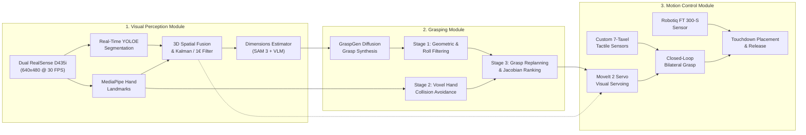

<div align="center">

<!--  -->

<picture>
  <source media="(prefers-color-scheme: dark)" width="200" srcset="images/CROP_logo.png">
  <source media="(prefers-color-scheme: light)" width="200" srcset="images/logo_color_black_BrokenArm.png">
  
</picture>


# Human-to-Robot (H2R) Handover System
### Team BrokenArm · Smart Systems Technologies (SAT) · University of Klagenfurt
**Robotic Grasping and Manipulation Competition (RGMC 2026) @ IEEE ICRA 2026, Vienna**

[](https://releases.ubuntu.com/22.04/)
[](https://docs.ros.org/en/humble/)
[](https://www.python.org/)
[](https://isocpp.org/)
[](https://www.nvidia.com)
[](https://icra2026.org/)
[](https://corsmal.github.io/events/rgmc/icra2026/leaderboards.html)

<br>

<div align="center">

<p><em>Physical deployment of the BrokenArm H2R Handover System.</em></p>
</div> 

<!-- <div align="center">

<p><em>Official physical deployment and live evaluation of the BrokenArm H2R Handover System at ICRA 2026, Vienna.</em></p>
</div>  -->

<div align="center">

<p><em>Complete functional architecture showing the Visual Perception, Grasping, and Motion Control modules.</em></p>
</div>

---

## 💡 Overview & Competition Achievements

<div align="left">
Achieving safe, compliant, and responsive Human-to-Robot (H2R) handovers remains a significant challenge, especially when deploying rigid, high-payload industrial hardware with minimal safety margins. 

Developed by team **BrokenArm** from the [SAT Group](https://www.aau.at/en/smart-systems-technologies/sensors-and-actuators/) at the [University of Klagenfurt](https://www.aau.at/en/), this system was engineered for the **Human-to-Robot Handover Track** of the 11th Robotic Grasping and Manipulation Competition (**RGMC 2026**) held at **IEEE ICRA 2026** in Vienna, Austria.

### 🏆 Benchmark Results
* **1st Place in Qualification Stage (based on CORSMAL Benchmark):** Highest overall qualification score (**71.41 points**, 75.9% success rate) evaluating perception and physical reasoning under sensory ambiguity across 288 container configurations among other qualifying teams of 2026 competition edition.
* **75.0% Success Rate in Live Finals:** Evaluated across 24 unseen, diverse configurations featuring complex container geometries, variable liquid fillings, transparency, and deformability without trial repetitions.
* **Rapid Interaction Latency:** Handover execution completed in an average of **6.08 seconds** (a 30.5% latency reduction via real-time optimization).

### 📄 Resources & Media
* **Technical Report:** [Read our full Technical Report (PDF)](https://corsmal.github.io/events/rgmc/icra2026/teams.html)
* **Demonstration Video:** [Watch on YouTube](https://www.youtube.com/watch?v=0MkqkYvmN5c)
* **Setup Guide:** [Step-by-step Installation & Execution Guide (SETUP.md)](SETUP.md)
* **Simulation Digital Twin:** [Isaac Sim 4.5.0 Environment (handover_sim/README.md)](handover_sim/README.md)
</div>

---

## 🎬 Live Demonstrations & Media Gallery

### Real-Time Handovers at ICRA 2026 (Live Competition)
The system executes zero-shot handovers across diverse container types, dynamic human movements, and lighting variations:

<div align="center">

| Can Handover | Opaque Cup Handover |
| :---: | :---: |
|  |  |

| Transparent Glass Handover | Paper Box Handover |
| :---: | :---: |
|  |  |

</div>

<br>

### Simulation & Setup
<div align="center">

| ROS 2 / MoveIt 2 Mock Simulation | Dual-Camera Setup & Calibration |
| :---: | :---: |
|  |  |
| *Fast kinematic verification in MoveIt 2* | *Multi-view eye-on-base calibration via easy_handeye2* |

</div>

---

## ✨ Key System Contributions

<div align="left">
  
1. **Dual-Camera 3D Spatial Perception & Tracking:**
   - Real-time open-vocabulary object segmentation using **YOLOE** combined with 2D hand landmark tracking via **MediaPipe**.
   - Spatial back-projection into 3D point clouds with pinhole models and base-frame fusion running at a stable 30 FPS.
   - Robust dynamic tracking with **Kalman filtering**, **One-Euro filtering**, outlier velocity gates, and constant-velocity trajectory prediction.
2. **Human-Aware Diffusion Grasp Synthesis:**
   - Rapid 6-DoF grasp generation powered by [NVlabs/GraspGen](https://github.com/NVlabs/GraspGen), conditioned on object dimensions estimated via **SAM 3** (with local **Qwen3-VL-8B** fallback).
   - **Adaptive Spherical Constraints:** Filter grasps based on azimuth $\phi$ and elevation $\theta$ approach cones.
   - **Roll Isomorphism Filtering:** Flat horizontal grasp alignment relative to world-Y ($\le 20.0^\circ$) to guarantee level finger interaction.
   - **Fast Ray-Casting Hand Collision Avoidance:** Rejects grasp poses intersecting the estimated human hand point cloud volume.
   - **Kinematic Feasibility & Jacobian Condition Ranking:** Ranks candidates by inverse kinematics solvability and Cartesian dexterity $\kappa(J) = \sigma_{\max} / \sigma_{\min}$.
3. **Multi-Modal Closed-Loop Interaction Control:**
   - **MoveIt 2 Servo Visual Servoing:** Continuously tracks moving targets with adaptive distance convergence.
   - **High-Sensitivity Tactile Feedback:** Custom barometric-pressure-sensor arrays (7 taxels/finger) streaming over BLE at up to 60 FPS per finger, detecting delicate contact on deformable objects via hysteresis thresholds.
   - **Wrist-Mounted Force-Torque Touchdown:** Robotiq FT 300-S detects surface touchdown during placement to automatically terminate downward motion and trigger gripper release.
4. **Rapid On-Site Deployment:**
   - Distributed monorepo architecture separating perception from motion control over a 2.5 Gbps Ethernet link with **Eclipse Cyclone DDS**.
   - Dual-camera extrinsics calibrated in under 10 minutes (0.5–2 cm registration accuracy).

</div>

---

## 🏗️ System Architecture

The system decouples high-frequency motion execution from heavy vision models across three cooperating modules:



---

## 🤖 Robot Hardware & Sensor Suite

<div align="center">

<p><em>Physical hardware assembly featuring the UR7e arm, Robotiq 2F-140, FT 300-S, and custom tactile arrays.</em></p>
</div>

| Component | Hardware Specification | Function & Integration |
| :--- | :--- | :--- |
| **Manipulator** | **Universal Robots UR7e** (6-DoF, 1 Gbps Ethernet) | High-payload collaborative arm executing real-time MoveIt 2 Servo trajectories. |
| **End-Effector** | **Robotiq 2F-140** (Parallel-jaw, 140 mm stroke) | Large-stroke gripper accommodating variable object shapes, interfaced via ROS 2. |
| **Dual Cameras** | **$2\times$ Intel RealSense D435i** (RGB-D @ 30 FPS) | Static multi-view workspace monitoring, calibrated via `easy_handeye2`. |
| **Force-Torque Sensor** | **Robotiq FT 300-S** (Wrist-mounted) | Surface touchdown detection during container placement and collision monitoring. |
| **Tactile Finger Arrays** | **Custom SAT Sensor** (7 taxels/finger, BLE @ 60 FPS) | High-sensitivity barometric pressure sensor array for delicate and deformable grasping. |

> **Tactile Sensor Note:** The tactile workspace (`utils/tactile_ws`) is fully modular—any commercial or custom sensor can be plugged in by publishing to the standard ROS 2 topics. For schematics or hardware specifications of the lab's custom tactile sensor, please contact the [SAT Lab](https://www.aau.at/en/smart-systems-technologies/sensors-and-actuators/).

---

## 🖥️ Computing & Network Infrastructure

<div align="left">

To guarantee strict real-time execution, computation is split across two workstations over a **2.5 Gbps Ethernet link**:

* **Vision Pipeline Workstation:**
  - **CPU:** AMD Ryzen 9 9950X (16-Core, 32-Thread)
  - **GPU:** NVIDIA RTX PRO 6000 Blackwell (96 GB VRAM)
  - **Role:** Real-time object detection (YOLOE), SAM 3 segmentation, MediaPipe tracking, 3D fusion, and GraspGen synthesis.
* **Motion Planning Workstation:**
  - **CPU:** AMD Ryzen 9 5950X (16-Core, 32-Thread)
  - **Network:** Dedicated 1 Gbps hardware connection to the UR7e controller.
  - **Role:** High-frequency visual servoing, MoveIt 2 trajectory planning, and low-level robot control.
* **Middleware:** **Ubuntu 22.04 LTS** + **ROS 2 Humble** with **Eclipse Cyclone DDS** (`rmw_cyclonedds_cpp`).

</div>

---

## 📦 Quick Start Summary

For the complete, step-by-step installation, dependency configuration, package compilation, and `tmux` startup commands, please refer to our dedicated guide:

👉 **[Complete Setup & Deployment Guide (SETUP.md)](SETUP.md)**

<div align="left">

### Fast Clone

```bash
# Install Git LFS
git lfs install

# Clone repository with all submodules
git clone --recurse-submodules https://github.com/aau-sat/H2R-Handover.git ~/rgmc-2026
```

### Handover Execution Workflow
```bash
# 1. On Vision Workstation (Terminal 1 - Persistent Services):
cd ~/rgmc-2026/utils/visual_pipeline_setup && sh service_setup_tmux.sh

# 2. On Vision Workstation (Terminal 2 - Restart per Handover):
cd ~/rgmc-2026/utils/visual_pipeline_setup && sh vision_setup_tmux.sh

# 3. On Motion Workstation (Terminal 1 - Persistent Robot Drivers):
cd ~/rgmc-2026/utils/ur && sh ur_setup_tmux.sh

# 4. On Motion Workstation (Terminal 2 - Restart per Handover):
cd ~/rgmc-2026/utils/ur && sh moveit_setup_tmux.sh real
```

</div>

---

## 🔬 Simulation Digital Twin (`handover_sim`)

<div align="left">

We provide a digital twin environment based on **NVIDIA Isaac Sim 4.5.0** and **Isaac Lab 1.x**:
* Replays realistic human handover motions using the **GenH2R** dataset from the [work of Wang et al](https://genh2r.github.io/).
* Accurately simulates the UR10 (IsaacSim) / UR7e (Rviz) robot, Robotiq gripper, MANO articulated hand models, and YCB objects.
* Streams synthetic RGB-D frames directly to ROS 2 topics for software-in-the-loop benchmarking.

Refer to **[handover_sim/README.md](handover_sim/README.md)** for execution commands and configuration details.

</div>

<div align="center">

<p><em>Digital twin of the environment recreated in Isaac Sim.</em></p>
</div>

---

## 👥 Team BrokenArm

<div align="left">

Developed at the **[Smart Systems Technologies (SAT) Group](https://www.aau.at/en/smart-systems-technologies/sensors-and-actuators/)**, Department of Sensors, Actuators & Modular Robotics, **[University of Klagenfurt](https://www.aau.at/en/)**, Austria:

* **Nadezhda Varzonova** (Team & Technical Lead)
* **Daniel Johannes Bugelnig**
* **Valerian Pichler**
* **Markus Herbert Kräuter**
* **Christoph Wilhelm Rauter**

### Technical Support & Assistance
* **Amon Peter Ferreira-Weratschnig** (Mechanical, power system design & technical support)
* **Dr. Tobias Mitterer** (Firmware support & on-site testing)
* **Dr. Barnaba Ubezio** (Qualification assistance)

### Project Supervisors
* **Prof. Hubert Zangl** (Head of SAT Lab, Main Supervisor)
* **Dr. Serkan Ergun** (Secondary Supervisor)

</div>

---

## 📖 Citation

If you use this system, code, simulation framework, or benchmark findings in your research, please cite our technical report:

<div align="left">

```bibtex
@techreport{brokenarm2026h2r,
  title={{RGMC2026 H2R Handover Track Solution}},
  author={Varzonova, Nadezhda and Bugelnig, Daniel Johannes and Kr{\"a}uter, Markus Herbert and Pichler, Valerian and Rauter, Christoph Wilhelm},
  institution={University of Klagenfurt, Smart Systems Technologies (SAT)},
  year={2026},
  note={Robotic Grasping and Manipulation Competition (RGMC) at IEEE ICRA 2026}
}
```

</div>

You can also cite this repository directly using GitHub's "Cite this repository" button in the sidebar or via [CITATION.cff](CITATION.cff).

---

## 🤝 Acknowledgements & Third-Party Credits

<div align="left">

The BrokenArm system incorporates, builds upon, or interfaces with the following open-source frameworks:
* **[GraspGen](https://github.com/NVlabs/GraspGen):** 6-DoF diffusion grasp generation model.
* **[MANO Hand Model](https://mano.is.tue.mpg.de/):** Articulated 3D human hand model (Max Planck Institute).
* **[YCB Object Set](https://www.ycbbenchmarks.com/):** Standardized object models and benchmark geometries.
* **[easy_handeye2](https://github.com/marcoesposito1988/easy_handeye2):** Eye-on-base camera calibration software for ROS 2.
* **[topic_based_ros2_control](https://github.com/qdeyna/ur10e_2f140_topic_based_ros2_control):** ROS 2 control and MoveIt 2 integration by Quentin Deyna, Nikolas Schwarz (Uni Leoben), and PickNik Robotics.
* **[SAM 3](https://github.com/facebookresearch/sam3):** Segment Anything Model 3 (Meta AI Research).
* **[YOLO-E](https://docs.ultralytics.com/models/yoloe):** Real-time open-vocabulary object detector and segmenter.
* **[GenH2R](https://github.com/chenjy2003/genh2r):** Dynamic handover motion sequences used in simulation.
* **[InstantMesh](https://github.com/TencentARC/InstantMesh):** Rapid 3D mesh generation from single images (Tencent ARC), not used in the competition solution.

</div>

---

## 🏢 Sponsorship & Ownership

This project was funded and sponsored by the **[University of Klagenfurt](https://www.aau.at/en/)**, Department of Smart Systems Technologies, **Sensors, Actuators & Modular Robotics (SAT) Group**, and supported by the Austrian Research Promotion Agency (**FFG**) under the project **AdapTex**. 

This codebase is officially maintained and owned by the **SAT Group** ([aau-sat](https://github.com/aau-sat)).
